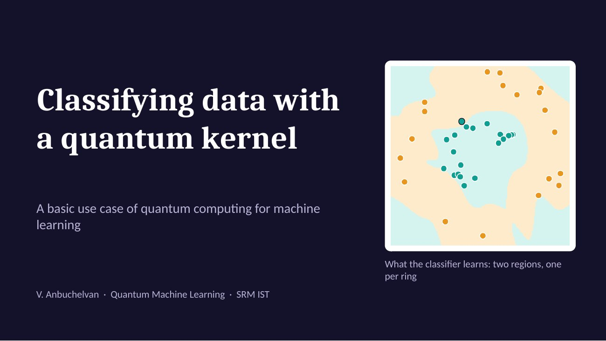

# Classifying data with a quantum kernel

A basic use case of quantum computing for machine learning, made for my Quantum Machine Learning course at SRM IST: a support vector machine whose kernel is computed by a two-qubit circuit.

**Site and live demo:** https://zanyanbu.github.io/quantum-kernel-classifier/

**Slides:** [Quantum-Kernel-Classifier.pptx](Quantum-Kernel-Classifier.pptx) · [PDF](Quantum-Kernel-Classifier.pdf)



## The idea

Two rings of points cannot be separated by a straight line. A support vector machine only needs to know how similar each pair of points is, so the similarity measure (the kernel) can be swapped. Here it is measured by a quantum circuit:

1. **Encode.** A ZZ feature map (Hadamard, phase and ZZ gates) turns a point's two features into a two-qubit state.
2. **Compare.** Encode one point, undo the encoding of another, and measure. The probability of reading `00` is the kernel value for that pair.
3. **Train.** Fill the kernel matrix and pass it to an ordinary support vector machine.

## Result

120 points on two rings, 80 for training and 40 for testing.

| Kernel | Test accuracy |
|---|---|
| Linear (classical) | 60.0% |
| Quantum, 1 layer | 95.0% |
| Quantum, 2 layers | 97.5% |
| RBF (classical) | 100.0% |

Reproduce these numbers with:

```bash
node experiment.js
```

## What this does not show

- **No quantum advantage.** The classical RBF kernel does as well or better, and two qubits are trivial to simulate.
- **No noise.** The circuit is simulated exactly. Real hardware estimates each kernel value from repeated runs.
- **Cost.** `n` training points need `n(n−1)/2` circuits.

## Files

| File | What it is |
|---|---|
| `qkernel.js` | Datasets, the two-qubit feature map, the quantum kernel and a small SVM solver. Runs in the browser and in Node, with no dependencies. |
| `experiment.js` | Prints the accuracy table above. |
| `index.html`, `style.css`, `app.js` | The site and the live demo. |
| `Quantum-Kernel-Classifier.pptx` | The ten slides. |
| `assets/` | Pictures used by the slides and the site. |

## References

- Havlíček et al., "Supervised learning with quantum-enhanced feature spaces", *Nature* 567 (2019).
- Schuld and Killoran, "Quantum machine learning in feature Hilbert spaces", *Physical Review Letters* 122 (2019).

## Licence

MIT
